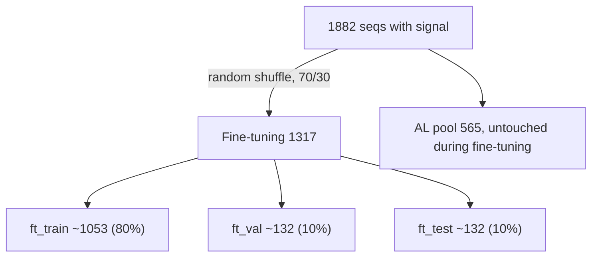

# 用 ChIP-ISO 信号 fine-tune ChIP-seq 预训练模型（预留 AL 数据）

先把 ChIP-ISO 中带数值信号的序列按单条序列随机划分，70% 划给 fine-tuning、30% 留作 active learning (AL) 池，并固化成 manifest 文件。再用 fine-tuning 部分的 log1p 信号做 MSE 回归，fine-tune 已在 ChIP-seq 上训练好的 240bp ConvTowerDomain_v6。实验全程使用预训练的原头，按"放开多少参数"排成 6 档：zero-shot、只训练原头，再从输出端往输入端逐步解冻 backbone。AL 池在 fine-tuning 过程中完全不使用。

## 实施清单

- [ ] 新建 `split_chipiso.py`：解析 FASTA 与信号，丢弃 NA，用固定 seed 打乱序列后做 70/30 的 fine-tuning/AL 随机划分，再在 fine-tuning 内部做 80/10/10 随机划分，写出 `chipiso_split.tsv` 并打印统计
- [ ] 在 `datamodule.py` 中实现 `ChIPISODataModule`：读取 manifest，只用 `ft_*` 部分训练和验证，`test_split` 可选 `ft_test` 或 `al_pool`，做 log1p 和 one-hot，训练时做反向互补增强
- [ ] 在 `models.py` 中实现 `ConvTowerDomain_v6_FineTune`：加载 pretrained `state_dict`，支持 `calibrate_head` 和 `unfreeze_level`（0 到 4），卷积层 BN 始终 eval，头和 backbone 分别设学习率，记录 val Pearson/Spearman
- [ ] 在 `on_test_epoch_end` 的回归分支中加入 `hp/SpearmanR`
- [ ] 新建 `finetune_chipiso_config.yaml` 和 `submit_finetune.sh`
- [ ] 按"实验设计"一节依次运行第 1 到 6 档，在 `ft_val` 和 `ft_test` 上对比指标

## 关键事实（已核实）

- 预训练模型：`checkpoints/FOXA1_A549_rep1_center_win240_wd1e-4/best-epoch=40-val_loss=0.344953.ckpt`。参数为 `input_len=240`、`conv1d_filter=128`、`seqonly=True`、`classification=True`、`weight_decay=1e-4`，与 ChIP-ISO 的 240bp 序列长度一致。`FOXA1_run_*` 这几个 checkpoint 是 1024bp 的，不能直接用。
- 数据：`ChIP-ISO_Lucy_lab/ChIP-ISO_signal/A549_FoxA1_lib1_plus_2_all.fasta` 有 3329 条序列。`ChIP_ISO_signal_NM0_1_all.txt` 中有 1882 条带数值的信号，另有 1321 条 `#N/A`，126 条不在信号文件里，后两类都丢弃。数据里没有 lib1 和 lib2 的标记，所以直接在这 1882 条序列上随机划分。
- 序列首尾都有约 20bp 的固定 adapter，含小写碱基，有 2 条是 239bp（需补 N 到 240）。编码沿用 `seqchromloader.utils.dna2OneHot`（ACGT 顺序，自动转大写），与预训练时保持一致。
- 不能直接用 LightningCLI 的 `--ckpt_path`：它会恢复 optimizer、epoch 和 loop 状态，属于断点续训，不是 fine-tune。正确做法是在模型 `__init__` 里只加载 `state_dict`。

## 数据划分



## 实验设计

模型结构（`seqonly=True`）：

```
DNA one-hot (4×240)
 → seq_stem            卷积 k=25 + BN                   约 13K 参数
 → conv_tower[0]       128→256，池化到 120 个位置        约 0.11M
 → conv_tower[1]       256→512，池化到 60 个位置         约 0.46M
 → conv_tower[2]       512→1024，池化到 30 个位置        约 1.8M
 → 位置编码 + transformer 层（1 层）                      约 6.3M
      ├ self-attention                                   约 4.2M
      └ FFN（两个线性层）+ LayerNorm                       约 2.1M
 → 原头：post_attn（每个位置的 1024 维压成 1 个分数，共 30 个）
          + main_pred（Linear(30, 1)，按位置加权求和）       约 3K
```

原头最后输出一个数。预训练时这个数是二分类的 logit，fine-tune 时直接把它当作 `log1p(signal)` 的预测值，所以结构不用改，只是把损失从 BCE 换成 MSE。所有档位都使用并训练原头。

| 编号 | 训练的部分 | 新增解冻的部分 | 可训练参数 |
|---|---|---|---|
| 1 | 不训练 | zero-shot（只做线性校准） | 2 |
| 2 | 原头 | 无，backbone 全部冻结 | 3,106 |
| 3 | 原头 + transformer 的 FFN 和 LayerNorm | attention 之后的"加工"部分 | 约 2.1M |
| 4 | 原头 + 整个 transformer 层 | 再加上 self-attention | 约 6.3M |
| 5 | 原头 + transformer + `conv_tower[2]` | 最后一个卷积块 | 约 8.1M |
| 6 | 全部（再加 `conv_tower[0..1]` 和 `seq_stem`） | 所有卷积层 | 约 8.7M |

- **校准**：原头输出的是 logit 尺度（约 -10 到 10），而 `log1p(signal)` 只有 0 到 2 左右。直接用 MSE 训练时，一开始的大梯度会冲掉预训练学到的排序。所以先在 `ft_train` 上用最小二乘拟合 `y = a * logit + b`，再把 `a`、`b` 折算进 `main_pred` 的权重和偏置。线性变换不改变 Spearman 和 Pearson，只让 MSE 可比。
- **第 1 档**：只做校准，不训练。
- **第 2 到 6 档**：**相互独立**，每档都从 ChIP-seq 预训练模型出发，先校准，再按表格解冻对应的部分训练。各档之间唯一的区别是解冻了多少层，不依赖其他档位的训练结果，可以并行运行。
  - 不需要先单独训练头再解冻（LP-FT）：那是为随机初始化的新头设计的，而校准后的原头一开始就在正确的尺度上，排序也来自预训练。
- 解冻顺序从输出端往输入端：越靠近输出的层越任务相关，越靠近输入的层越通用（识别 motif），最不应该被约 1000 条数据改动。
- 训练设置：
  - 头和解冻的 backbone 层分成两个参数组：头的学习率 1e-3，backbone 学习率 1e-5。头只有约 3K 参数，用 1e-5 训练 200 个 epoch 仍不收敛；backbone 用小学习率，避免冲掉预训练特征。
  - 卷积层（`seq_stem`、`conv_tower`）的 BatchNorm 始终保持 eval，即使在第 5、6 档解冻了卷积层也锁住统计量。batch 小、数据少，BN 统计量会不稳定。
- 所有档位使用同一份划分、同一个 seed，early stopping 监控 `val_loss`。指标以 Spearman 为主，同时报告 Pearson 和 MSE。

## 1. 新建 `split_chipiso.py`，一次性生成并固化划分

- 输出文件 `ChIP-ISO_Lucy_lab/ChIP-ISO_signal/chipiso_split.tsv`，列为 `name`、`family`、`signal`、`split`，其中 `split` 取值为 `ft_train`、`ft_val`、`ft_test`、`al_pool` 之一。后续 fine-tuning 和 AL 都只读这个文件，保证两边严格不重叠、结果可复现。
- 划分方式为按单条序列随机划分，不考虑序列之间的亲缘关系：
  - 用固定 seed（默认 0）打乱 1882 条序列的顺序。
  - 前 30%（565 条）作为 AL 池，剩下 70%（1317 条）进入 fine-tuning。
  - fine-tuning 部分再打乱一次，按 80/10/10 切成 `ft_train`、`ft_val`、`ft_test`。
- `family` 列只用于统计报告，不参与划分。它按名字前缀粗分序列类型，例如 `FOXA1_*`、基因组来源的 `seq*`、`E2W`/`E2m`、`F12*`、`ori/mut/rev/con` 组合、`CCND1e`、`*_scrambled`。
- 运行时打印每个 split 的样本数、信号分位数，以及各 `family` 在每个 split 中的数量，用来确认各部分分布相近。

## 2. 新增 `ChIPISODataModule`（写在 `datamodule.py` 里）

- 参数：`fasta_file`、`split_file`、`test_split="ft_test"`（也可以设成 `"al_pool"`）、`batch_size=64`、`num_workers=4`、`rc_augment=True`、`label_threshold=1.0`。
- train 和 val 只读取 `ft_train` 和 `ft_val`。test 读取 `test_split` 指定的部分。`al_pool` 只会在显式指定时用来做预测，永远不参与训练或 early stopping。
- 每个样本输出：
  - `seq`：形状 `(4, 240)`
  - `chrom`：`zeros(1, 240)`（`seqonly=True` 时会被忽略，但 `forward` 需要这个参数）
  - `target`：`log1p(signal)`，形状 `(1,)`
  - `label`：`signal >= label_threshold` 的二值标签，只用于测试散点图着色
- Dataloader 用内存中的 `TensorDataset`，数据量小，不需要 webdataset。
  - train/val batch 返回 `(seq, chrom, target, label)`，与 `models.py` 中 `training_step` 和 `validation_step` 的解包方式一致。
  - test batch 返回 `(key, seq, chrom, target, label, domain)`，与 `test_step` 一致。
  - 训练时以 0.5 概率做反向互补增强（预训练数据本身包含正负链）。

## 3. 新增 `ConvTowerDomain_v6_FineTune(ConvTowerDomain_v6)`（写在 `models.py` 里）

- 新参数：
  - `pretrained_ckpt: str`：在 `__init__` 中执行 `torch.load(...)["state_dict"]` 后 `load_state_dict(strict=True)`。所有档位都指向 ChIP-seq 预训练 checkpoint。
  - `calibrate_head: bool`：所有档位都使用，在 `ft_train` 上拟合 `a * logit + b` 并折算进 `main_pred`。从已 fine-tune 的 checkpoint 恢复时不会重复校准。
  - `unfreeze_level: int`：0 表示 backbone 全部冻结（第 2 档）；1 解冻 transformer 的 FFN 和 LayerNorm（第 3 档）；2 解冻整个 transformer 层（第 4 档）；3 再解冻 `conv_tower[2]`（第 5 档）；4 解冻全部（第 6 档）。
  - `head_lr`、`backbone_lr`：头和解冻的 backbone 层分别使用的学习率。
- 卷积层（`seq_stem`、`seq_conv_tower`）的 BatchNorm 通过重写 `train()` 始终保持 `eval()`，避免小数据集改写 running stats。
- 配置中设 `classification: False`，这样会自动走现有的 MSE 分支，测试阶段也会复用已有的 Pearson 散点图和 `predictions.txt` 输出。
- 重写 `configure_optimizers`，只把 `requires_grad=True` 的参数交给 AdamW，并按头和 backbone 分成两个参数组，CyclicLR 逻辑不变。
- 新增 `on_validation_epoch_end`：记录 `val_pearson` 和 `val_spearman`。小样本时 val MSE 噪声很大，相关系数更有参考价值。
- 在 `TrainingRoutineHook.on_test_epoch_end` 的回归分支里加一行 `hp/SpearmanR`。

## 4. 配置和提交脚本

- 新建 `finetune_chipiso_config.yaml`，以 `model_config.yaml` 为模板：
  - model 的 `class_path` 改为 `ConvTowerDomain_v6_FineTune`，网络结构参数与预训练 checkpoint 完全一致，`classification: False`，`pretrained_ckpt` 指向上面那个 best ckpt。
  - 默认值对应第 2 档：`calibrate_head: true`，`unfreeze_level: 0`，`head_lr: 1e-3`，`backbone_lr: 1e-5`，`weight_decay: 1e-4`，`dropout: 0.5`。其余档位只需通过命令行覆盖 `unfreeze_level`。
  - trainer：`max_epochs: 200`（约 1050 条训练样本，batch 64 时每个 epoch 只有约 17 个 step），EarlyStopping 监控 `val_loss`，`patience: 20`。
  - data 的 `class_path` 改为 `datamodule.ChIPISODataModule`，`split_file` 指向 `chipiso_split.tsv`，`test_split: ft_test`。
- 新建 `submit_finetune.sh`，参照 `submit_train.sh`，用 `RUN_NAME` 区分档位（例如 `${PREFIX}_level1` 到 `${PREFIX}_level6`）。`--config` 必须放在其他参数之前，否则配置文件里的值会覆盖命令行。

## 5. 运行顺序

1. 运行 `python split_chipiso.py` 生成 manifest，检查打印出的统计。
2. 第 1 档 zero-shot：`calibrate_head: true`，只做校准，不训练，直接在 `ft_test` 上 test，作为对照。
3. 第 2 到 6 档：都从预训练 checkpoint 出发，`calibrate_head: true`，`unfreeze_level` 依次设为 0、1、2、3、4，每档执行 `fit` 再执行 `test`。各档相互独立，可以作为单独的作业并行提交。
5. 运行 `chipiso_levels.py` 汇总 6 档在 `ft_val` 和 `ft_test` 上的 Spearman、Pearson 和 MSE，画出"解冻程度 vs Spearman"的曲线，并按 `ft_val` 选出最好的档位。可以额外用 `predictions.txt` 计算 WT 与 `_FOXA1mut` 配对的预测差值和真实差值的相关性，用来检验模型是否学到了突变效应。
6. 之后做 active learning 时，再用选定档位的 checkpoint 加 `--data.test_split al_pool` 对 AL 池做预测。

## 注意事项

- 随机划分会把同一亲本衍生的序列（WT 与突变体、反向互补、同一 enhancer 骨架上的设计变体）分散到不同 split。由于这些序列大部分碱基相同，`ft_val`、`ft_test` 和 AL 池里会有与训练集高度相似的序列，评估结果可能偏乐观。报告结果时需要说明这一点。
- 测试集只有约 132 条，档位之间 Spearman 相差 0.02 到 0.03 很可能只是噪声。解读梯度趋势时应关注整体走向，不要过度解读相邻档位的小差异。
- 最终档位的选择只看 `ft_val`，`ft_test` 只用于最后报告。
- 固定 adapter 在预训练的基因组窗口里不存在，属于轻微的分布偏移，fine-tune 会自行吸收，暂不做特殊处理。
