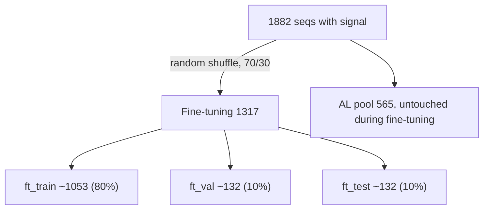

# 用 ChIP-ISO 信号 fine-tune ChIP-seq 预训练模型（预留 AL 数据）

先把 ChIP-ISO 中带数值信号的序列按单条序列随机划分，70% 划给 fine-tuning、30% 留作 active learning (AL) 池，并固化成 manifest 文件。再用 fine-tuning 部分的 log1p 信号做 MSE 回归，fine-tune 已在 ChIP-seq 上训练好的 240bp ConvTowerDomain_v6，采用先冻结 backbone、再全量微调的两阶段策略。AL 池在 fine-tuning 过程中完全不使用。

## 实施清单

- [ ] 新建 `split_chipiso.py`：解析 FASTA 与信号，丢弃 NA，用固定 seed 打乱序列后做 70/30 的 fine-tuning/AL 随机划分，再在 fine-tuning 内部做 80/10/10 随机划分，写出 `chipiso_split.tsv` 并打印统计
- [ ] 在 `datamodule.py` 中实现 `ChIPISODataModule`：读取 manifest，只用 `ft_*` 部分训练和验证，`test_split` 可选 `ft_test` 或 `al_pool`，做 log1p 和 one-hot，训练时做反向互补增强
- [ ] 在 `models.py` 中实现 `ConvTowerDomain_v6_FineTune`：加载 pretrained `state_dict`，支持 `freeze_backbone` 和 BN eval，只优化可训练参数，记录 val Pearson/Spearman
- [ ] 在 `on_test_epoch_end` 的回归分支中加入 `hp/SpearmanR`
- [ ] 新建 `finetune_chipiso_config.yaml` 和 `submit_finetune.sh`
- [ ] 依次运行 zero-shot test、Stage 1（冻结 backbone）、Stage 2（全量微调），在 `ft_test` 上对比指标，并输出最终模型在 `al_pool` 上的预测作为 AL 起点

## 关键事实（已核实）

- 预训练模型：`checkpoints/FOXA1_20261001_140424/best-epoch=40-val_loss=0.344953.ckpt`。参数为 `input_len=240`、`conv1d_filter=128`、`seqonly=True`、`classification=True`、`weight_decay=1e-4`，与 ChIP-ISO 的 240bp 序列长度一致。`FOXA1_run_*` 这几个 checkpoint 是 1024bp 的，不能直接用。
- 数据：`ChIP-ISO_Lucy_lab/ChIP-ISO_signal/A549_FoxA1_lib1_plus_2_all.fasta` 有 3329 条序列。`ChIP_ISO_signal_NM0_1_all.txt` 中有 1882 条带数值的信号，另有 1321 条 `#N/A`，126 条不在信号文件里，后两类都丢弃。数据里没有 lib1 和 lib2 的标记，所以直接在这 1882 条序列上随机划分。
- 序列首尾都有约 20bp 的固定 adapter，含小写碱基，有 2 条是 239bp（需补 N 到 240）。编码沿用 `seqchromloader.utils.dna2OneHot`（ACGT 顺序，自动转大写），与预训练时保持一致。
- 不能直接用 LightningCLI 的 `--ckpt_path`：它会恢复 optimizer、epoch 和 loop 状态，属于断点续训，不是 fine-tune。正确做法是在模型 `__init__` 里只加载 `state_dict`。

## 数据划分

## 1. 新建 `split_chipiso.py`，一次性生成并固化划分

- 输出文件 `ChIP-ISO_Lucy_lab/ChIP-ISO_signal/chipiso_split.tsv`，列为 `name`、`family`、`signal`、`split`，其中 `split` 取值为 `ft_train`、`ft_val`、`ft_test`、`al_pool` 之一。后续 fine-tuning 和 AL 都只读这个文件，保证两边严格不重叠、结果可复现。
- 划分方式为按单条序列随机划分，不考虑序列之间的亲缘关系：
  - 用固定 seed（默认 0）打乱 1882 条序列的顺序。
  - 前 30%（565 条）作为 AL 池，剩下 70%（1317 条）进入 fine-tuning。
  - fine-tuning 部分再打乱一次，按 80/10/10 切成 `ft_train`、`ft_val`、`ft_test`。
- `family` 列只用于统计报告，不参与划分。它按名字前缀粗分序列类型，例如 `FOXA1_*`、基因组来源的 `seq*`、`E2W`/`E2m`、`F12*`、`ori/mut/rev/con` 组合、`CCND1e`、`*_scrambled`。
- 运行时打印每个 split 的样本数、信号分位数，以及各 `family` 在每个 split 中的数量，用来确认各部分分布相近。

## 2. 新增 `ChIPISODataModule`（写在 `datamodule.py` 里）

- 参数：`fasta_file`、`split_file`、`test_split="ft_test"`（也可以设成 `"al_pool"`）、`batch_size=64`、`num_workers=4`、`rc_augment=True`、`label_threshold=1.0`。
- train 和 val 只读取 `ft_train` 和 `ft_val`。test 读取 `test_split` 指定的部分。`al_pool` 只会在显式指定时用来做预测，永远不参与训练或 early stopping。
- 每个样本输出：
  - `seq`：形状 `(4, 240)`
  - `chrom`：`zeros(1, 240)`（`seqonly=True` 时会被忽略，但 `forward` 需要这个参数）
  - `target`：`log1p(signal)`，形状 `(1,)`
  - `label`：`signal >= label_threshold` 的二值标签，只用于测试散点图着色
- Dataloader 用内存中的 `TensorDataset`，数据量小，不需要 webdataset。
  - train/val batch 返回 `(seq, chrom, target, label)`，与 `models.py` 中 `training_step` 和 `validation_step` 的解包方式一致。
  - test batch 返回 `(key, seq, chrom, target, label, domain)`，与 `test_step` 一致。
  - 训练时以 0.5 概率做反向互补增强（预训练数据本身包含正负链）。

## 3. 新增 `ConvTowerDomain_v6_FineTune(ConvTowerDomain_v6)`（写在 `models.py` 里）

- 新参数：
  - `pretrained_ckpt: str`：在 `__init__` 中执行 `torch.load(...)["state_dict"]` 后 `load_state_dict(strict=True)`。
  - `freeze_backbone: bool`：冻结 `seq_stem` 和 `seq_conv_tower` 的参数，并在 `on_train_epoch_start` 中把这两部分的 BatchNorm 设成 `eval()`，避免小数据集改写 running stats。
  - `reinit_head: bool = False`：可选，重新初始化 `main_pred`，因为原输出是 logit 尺度。
- 配置中设 `classification: False`，这样会自动走现有的 MSE 分支，测试阶段也会复用已有的 Pearson 散点图和 `predictions.txt` 输出。
- 重写 `configure_optimizers`，只把 `requires_grad=True` 的参数交给 AdamW，CyclicLR 逻辑不变。
- 新增 `on_validation_epoch_end`：记录 `val_pearson` 和 `val_spearman`。小样本时 val MSE 噪声很大，相关系数更有参考价值。
- 在 `TrainingRoutineHook.on_test_epoch_end` 的回归分支里加一行 `hp/SpearmanR`。

## 4. 配置和提交脚本

- 新建 `finetune_chipiso_config.yaml`，以 `model_config.yaml` 为模板：
  - model 的 `class_path` 改为 `ConvTowerDomain_v6_FineTune`，网络结构参数与预训练 checkpoint 完全一致，`classification: False`，`pretrained_ckpt` 指向上面那个 best ckpt。
  - Stage 1：`freeze_backbone: True`，`lr: 1e-4`，`weight_decay: 1e-4`，`dropout: 0.5`。
  - trainer：`max_epochs: 200`（约 1050 条训练样本，batch 64 时每个 epoch 只有约 17 个 step），EarlyStopping 监控 `val_loss`，`patience: 20`。
  - data 的 `class_path` 改为 `datamodule.ChIPISODataModule`，`split_file` 指向 `chipiso_split.tsv`，`test_split: ft_test`。
- 新建 `submit_finetune.sh`，参照 `submit_train.sh`，用 `RUN_NAME` 区分 stage。

## 5. 运行顺序

1. 运行 `python split_chipiso.py` 生成 manifest，检查打印出的统计。
2. Step 0，zero-shot 基线：`python models.py test --config finetune_chipiso_config.yaml`。权重在 `__init__` 中加载，所以这一步直接得到预训练模型在 `ft_test` 上的 Pearson/Spearman，作为对照。
3. Stage 1：冻结 backbone，只训练 attention 和输出头，执行 `fit` 再执行 `test`。
4. Stage 2：`pretrained_ckpt` 改成 Stage 1 的 best ckpt，`freeze_backbone: False`，`lr: 1e-5`，再执行 `fit` 和 `test`。
5. 在 `ft_test` 上对比三次的 `hp/PearsonR` 和 `hp/SpearmanR`。可以额外用 `predictions.txt` 计算 WT 与 `_FOXA1mut` 配对的预测差值和真实差值的相关性，用来检验模型是否学到了突变效应。
6. 用最终 checkpoint 加 `--data.test_split al_pool` 跑一次 test，把 AL 池的预测保存下来，作为后续 active learning 的起点。

## 注意事项

- 随机划分会把同一亲本衍生的序列（WT 与突变体、反向互补、同一 enhancer 骨架上的设计变体）分散到不同 split。由于这些序列大部分碱基相同，`ft_val`、`ft_test` 和 AL 池里会有与训练集高度相似的序列，评估结果可能偏乐观。报告结果时需要说明这一点。
- fine-tuning 训练集只有约 1050 条，单次划分的方差很大。如果要报告结果，可以在 fine-tuning 部分内部做 5-fold KFold，AL 池保持不动。这一项作为后续可选扩展。
- 固定 adapter 在预训练的基因组窗口里不存在，属于轻微的分布偏移，fine-tune 会自行吸收，暂不做特殊处理。
