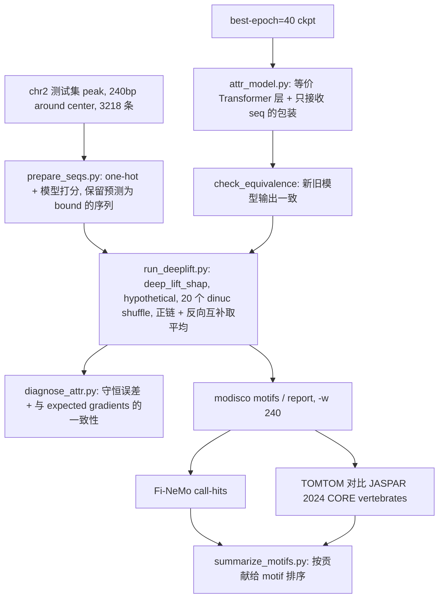
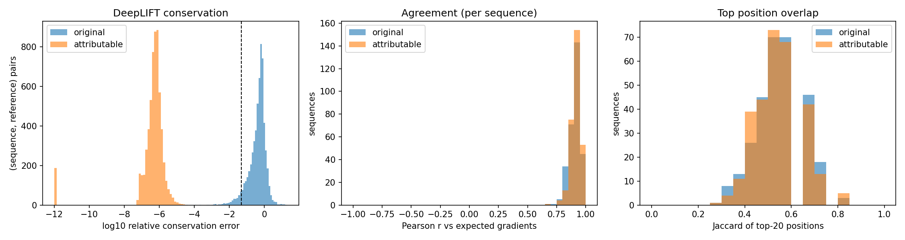
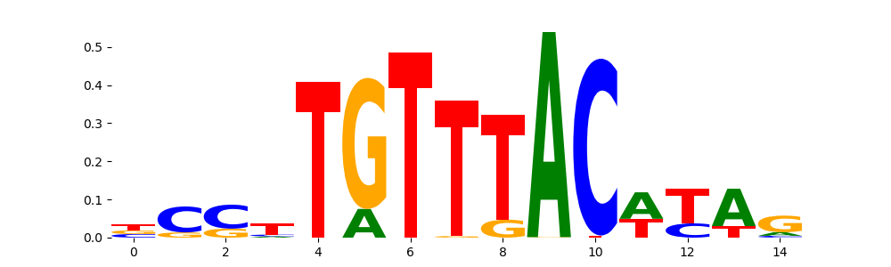
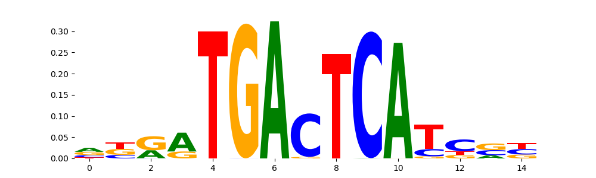
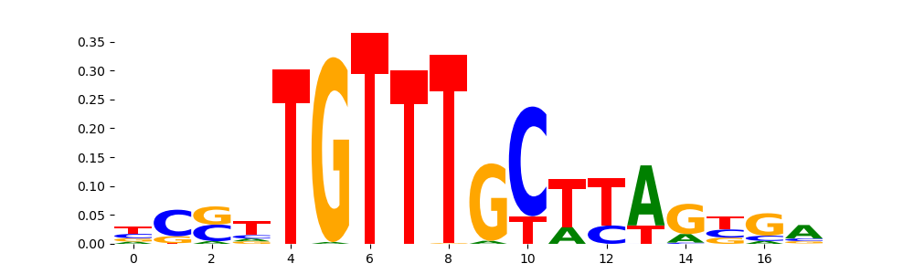
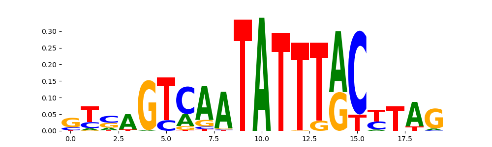
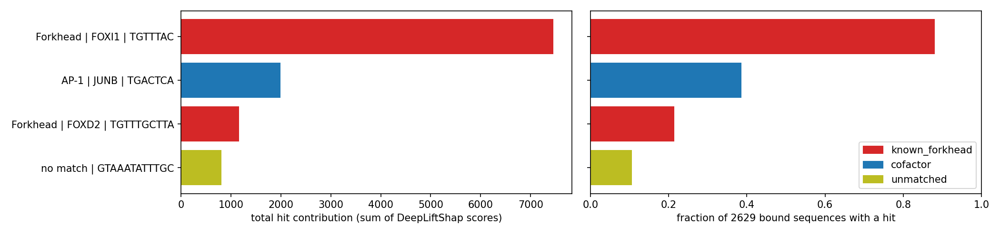
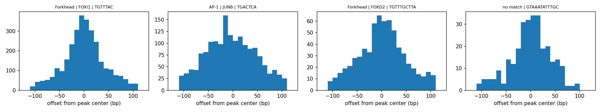
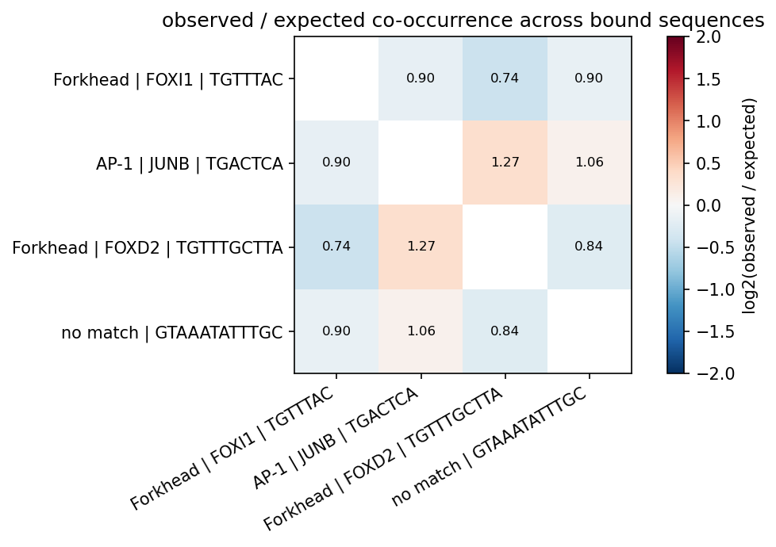

# 用 DeepLiftShap + TF-MoDISco 找 FOXA1 bound 的高贡献 motif

在预训练的 FOXA1 A549 240bp ChIP-seq classifier 上，用 tangermeme 1.5.0 的 `deep_lift_shap`（配合一个可归因的等价 Transformer 层）计算 hypothetical contribution，再依次用 TF-MoDISco、TOMTOM（对比 JASPAR）和 Fi-NeMo 找出并量化对 bound 贡献最高的 motif。不包含 tangermeme 的序列扰动验证。

## 实施清单

- [x] 在 `rotation` 环境安装 `tangermeme==1.5.0` 和 `finemo`，下载 JASPAR 2024 CORE vertebrates 的 meme 文件
- [x] `interpret/prepare_seqs.py`：从 chr2 center 240bp peak 生成 `ohe.npz`、`regions.bed`、`preds.tsv`，并按 `prob >= 0.5` 过滤
- [x] `interpret/attr_model.py`：用 `BilinearOp`、`nn.Softmax`、`nn.ReLU` 写等价 Transformer 层，加 `SeqOnly` 包装和输出一致性检查
- [x] `interpret/run_deeplift.py`：`deep_lift_shap`（hypothetical，20 个 shuffle），正链和反向互补取平均，输出 `hyp.npz`
- [x] `interpret/diagnose_attr.py`：在原模型和等价模型上比较守恒误差，并和 expected gradients 比较一致性
- [x] 运行 `modisco motifs`（`-w 240`）和 `modisco report`（带 JASPAR）
- [x] `interpret/annotate_patterns.py`：根据 TOMTOM 结果给 pattern 归类（已知、共结合、复合、低复杂度、未匹配）
- [x] 运行 Fi-NeMo：extract-regions、call-hits、report
- [x] `interpret/summarize_motifs.py`：输出 `motif_ranking.tsv`，以及贡献排名图和位置分布图
- [x] 新建 `submit_interpret.sh`（slurm GPU 作业），并在会议文档中补充方法

## 整体流程



## 为什么需要等价 Transformer 层

DeepLIFT 的规则只能挂在 `nn.Module` 上。`rotation` 环境里的 captum 0.7.0（PyPI 最新的 0.9.0 也一样）不支持 `nn.GELU`，也没有 attention 和 `LayerNorm` 的规则。tangermeme 1.5.0 的 `deep_lift_shap` 有 `GELU`、`nn.Softmax`、`nn.LayerNorm` 的规则，还提供 `BilinearOp` 处理矩阵乘法。但 `nn.TransformerEncoderLayer` 内部的 attention 和 FFN 激活都是函数式调用，规则挂不上去，所以需要把这一层改写成由可挂钩模块组成的等价层。

## 已核实的事实

- 模型：[checkpoints/FOXA1_A549_rep1_center_win240_wd1e-4/best-epoch=40-val_loss=0.344953.ckpt](../checkpoints/FOXA1_A549_rep1_center_win240_wd1e-4/best-epoch=40-val_loss=0.344953.ckpt)。参数为 `input_len=240`、`conv1d_filter=128`、`conv_tower_depth=4`、`attn_num_layers=1`、`attn_num_heads=8`、`attn_dim_feedforward=1024`、`seqonly=True`，`forward` 输出 logit。
- 测试染色体是 chr2，验证染色体是 chr3，见 [post_run.yaml](../ChIP-ISO_Lucy_lab/FoxA1_ChIP_Replicate1_Data/FOXA1_A549_rep1_center_win240/post_run.yaml)。
- `single_test_readcount_pos_shift.bed` 一共 11230 行，是 3218 个 peak 平移增强、再加正负链后的结果，同一个 peak 被重复了很多次，**不适合直接给 MoDISco**。所以改用 [FoxA1_ChIP_A549_MACS2_callpeak_narrowPeak_240bp_around_center.bed](../ChIP-ISO_Lucy_lab/FoxA1_ChIP_Replicate1_Data/FoxA1_ChIP_A549_MACS2_callpeak_narrowPeak_240bp_around_center.bed) 中 chr2 的部分：每个 peak 一条，共 3218 条，取 peak 中心 240bp，和模型名中的 `center_win240` 一致。
- `rotation` 环境里已有 `modisco-lite 2.2.0`、`tomtom`、`pyfaidx`、`seqchromloader`。还缺 `tangermeme==1.5.0`、`finemo`，以及 JASPAR 的 meme 文件。
- 登录节点没有 GPU，计算要通过 slurm 提交，参照 [submit_test.sh](../submit_test.sh)。

## 步骤

所有新脚本放在 `interpret/` 目录，输出放在 `results/interpret/FOXA1_A549_win240/`。

### 0. 环境准备

- 在 `rotation` 环境里安装 `tangermeme==1.5.0`，以及 Fi-NeMo（`finemo`，从 GitHub 安装）。
- 下载 `JASPAR2024_CORE_vertebrates_non-redundant_pfms_meme.txt`。

### 1. `interpret/prepare_seqs.py`：准备序列

- 读 center bed，取出 chr2 的 3218 个区域。用 `pyfaidx` 从 `hg38.fa` 取序列，再用 `seqchromloader.utils.dna2OneHot` 编码（ACGT 顺序，和训练一致），得到 `(N, 4, 240)`。
- 用原模型在 float32、`eval()` 状态下打分，记录 logit 和 sigmoid 后的概率。
- 默认只保留预测为 bound 的序列（`prob >= 0.5`，阈值可改），并打印保留了多少条。
- 输出：`ohe.npz`、`regions.bed`（narrowPeak 格式，summit 设为 120，供 Fi-NeMo 用）、`preds.tsv`。

### 2. `interpret/attr_model.py`：可归因的等价模型

- `AttributableEncoderLayer`：按 `nn.TransformerEncoderLayer`（`norm_first=False`、`batch_first=False`）的计算顺序重写一遍：
  - 用 `in_proj_weight` 和 `in_proj_bias` 得到 Q、K、V，拆成 8 个头，Q 乘以 \(1/\sqrt{d_{head}}\)。
  - `scores = BilinearOp()(q, k.transpose(-1, -2))`，`attn = nn.Softmax(dim=-1)(scores)`，`out = BilinearOp()(attn, v)`，然后过 `out_proj`。
  - 残差连接加 `norm1`（`nn.LayerNorm`），然后 FFN：`linear1`、`nn.ReLU()`、`linear2`，再残差加 `norm2`。
  - 权重全部直接从原层拷贝，不重新训练。
- `build_attr_model(ckpt)`：载入 `ConvTowerDomain_v6`，把 `transformer_encoder` 里的层换成上面的等价层，再用 `SeqOnly` 包装成 `forward(seq)`，内部 `chrom` 传 0，输出形状 `(N, 1)` 的 logit，设为 `eval()`、float32。
- `check_equivalence()`：用 512 条真实序列比较新旧模型的输出，要求 `max |diff| < 1e-4`，否则直接报错。
- 其余模块不用改：`GELU`、`LeakyReLU`、`MaxPool1d` 都在 tangermeme 的默认规则里；`BatchNorm` 在 eval 状态下是线性的；残差、位置编码、`Rearrange` 都是线性操作。

### 3. `interpret/run_deeplift.py`：计算 hypothetical contribution

- `deep_lift_shap(model, X, hypothetical=True, n_shuffles=20, random_state=0, warning_threshold=1e-3)`，reference 用默认的 dinucleotide shuffle。
- 对反向互补序列 `X.flip(1, 2)` 再算一次，结果 `.flip(1, 2)` 翻回原方向，和正链结果取平均。
- 输出 `hyp.npz`，形状 `(N, 4, 240)`。另外保存真实碱基的贡献（`hyp * ohe`），用来画 logo 和做检查。

### 4. `interpret/diagnose_attr.py`：判断 DeepLIFT 是否可用

在 300 条序列的子集上，分别用"原模型"和"等价模型"跑一遍（`raw_outputs=True`、`return_references=True`）：

- **守恒误差**：对每一对序列和 reference，计算 \(\sum \text{mult}\cdot(x-r)\) 与 \(f(x)-f(r)\) 的相对误差，排除 \(|f(x)-f(r)|\) 很小的那些对，报告中位数和 90 分位数。预期等价模型的误差远小于原模型，中位数小于 5% 视为可用。
- **一致性**：用同样的 reference 跑 expected gradients（对 20 个 dinucleotide shuffle 分别做 Integrated Gradients 再取平均：沿 reference 到序列的直线路径取 50 步，对梯度求平均，再按 hypothetical 公式投影到 4 个碱基），计算每条序列上两种方法真实碱基贡献的 Pearson 相关，以及贡献最高的前 20 个位置的 Jaccard 重合度。
- 输出 `diagnostics.tsv`，以及误差和相关性的直方图。如果守恒不达标，第 5 步改用 expected gradients 的结果，后续流程不变。

### 5. TF-MoDISco

- `modisco motifs -s ohe.npz -a hyp.npz -n 20000 -w 240 -o modisco_results.h5`。`-w` 必须设成 240，默认的 400 比序列长。
- `modisco report -i modisco_results.h5 -o report/ -s report/ -m JASPAR2024_...meme`，内部会调用 TOMTOM。
- 分别看 `pos_patterns`（促进 bound）和 `neg_patterns`（抑制 bound）。

### 6. 注释（`interpret/annotate_patterns.py`）

- 每个 pattern 取 TOMTOM q 值小于 0.05 的前 3 个匹配。按以下规则归类：已知 motif（预期是 Forkhead 类）；可能的共结合因子（AP-1、CEBP、GRHL、NFI 等）；复合 motif；低复杂度或 GC 富集；未匹配。最后两类就是"pattern 不一定是 motif"的情况，单独列出来。

### 7. Fi-NeMo

- `finemo extract-regions-modisco-fmt -s ohe.npz -a hyp.npz -p regions.bed -w 240 -o finemo_regions.npz`（peak 文件在这一步传入，`call-hits` 的 `-p` 已弃用）
- `finemo call-hits -r finemo_regions.npz -m modisco_results.h5 -o finemo/`，然后 `finemo report ... -W 240 -o finemo_report/`。
- 实际通过 `python interpret/finemo_compat.py <子命令>` 调用，原因见下面"与方案的差异"。
- 输出每条序列上的 motif hit：位置、方向、强度。

### 8. `interpret/summarize_motifs.py`：按贡献排序（最终交付物）

对每个 motif 汇总：

- 在 MoDISco 中的 seqlet 数；
- Fi-NeMo hit 覆盖的 bound 序列比例；
- 每个 hit 的平均贡献、总贡献；
- hit 位置相对 peak 中心的分布；
- 主要 motif 之间的共现情况。

输出 `motif_ranking.tsv`，再画一张贡献排名图和一张位置分布图。

### 9. 提交脚本和文档

- 新建 `submit_interpret.sh`，参照 [submit_test.sh](../submit_test.sh)，在 GPU 上依次跑第 1 到 4 步。第 5 到 8 步用 CPU 就够了，可以放在同一个作业里。
- 在 [10_05_2026 Meeting.md](10_05_2026%20Meeting.md) 里补充方法和结果。

## 不在本方案内

- tangermeme 的序列扰动验证（插入、删除 motif 后比较预测）。
- 可选扩展：加入 chr3 验证集的 peak 来扩大样本；或者在 `neg_gc` 序列上跑一遍作为负对照。

## 运行方式

```bash
sbatch submit_interpret.sh                                           # 全部步骤
STAGES="modisco annotate finemo summary" sbatch submit_interpret.sh   # 只跑部分步骤
```

所有输出在 `results/interpret/FOXA1_A549_win240/`，图另外复制到了 [images/foxa1_motif/](../images/foxa1_motif/)。

## 与方案的差异

- **GPU 上必须关掉 TF32**：`models.py` 设置了 `torch.set_float32_matmul_precision('medium')`，cuDNN 卷积默认也用 TF32。第一次在 GPU 上跑时，有 822 个 batch 的守恒误差超过 1e-3。`attr_model.py` 里改成 `"highest"` 并设置 `torch.backends.cudnn.allow_tf32 = False` 以后，警告数降为 0。
- **Fi-NeMo 和环境的兼容性**：
  - `finemo` 0.30 调用了 `np.stack(..., dtype=...)`，需要 numpy ≥ 1.24，而 `rotation` 环境里 numpy 被 conda 固定在 1.23.5。为了不动训练环境，新增了 `interpret/finemo_compat.py`，只在 Fi-NeMo 进程内补上这个参数。
  - `finemo report` 不兼容 polars 2.0，已把 polars 降到 1.44.2（polars 只有 finemo 在用）。
  - 安装 tangermeme 时，scikit-learn 被升级到 1.7.2，同时新装了 numba 0.68；`pip check` 没有报冲突。
- **样本数**：GPU 上打分后，`prob >= 0.5` 的序列是 2629 条（CPU 上是 2630 条，差的那 1 条正好落在阈值附近）。所有序列都不含 N。
- **注释规则**：GC 含量判为低复杂度的阈值从 0.3/0.7 收紧到 0.2/0.8。原阈值会把富含 AT、但并不重复的 pattern 3 误判成低复杂度。另外新增 `best_any` 和 `best_any_qval` 两列，记录即使不显著也最接近的 JASPAR motif。

## 结果

### DeepLIFT 在等价模型上可用

在 300 条序列、每条 20 个 reference（共 6000 对）上的诊断结果（`diagnostics_summary.tsv`）：

| 模型 | 守恒相对误差中位数 | 90 分位数 | 与 expected gradients 的 Pearson（中位数） | top-20 位置 Jaccard（中位数） |
|---|---|---|---|---|
| 原模型（`nn.TransformerEncoderLayer`） | 0.53 | 1.21 | 0.919 | 0.54 |
| 等价模型 | 5.6e-7 | 2e-6 | 0.924 | 0.54 |

- 等价模型和原模型的输出差值最大 2e-6，守恒误差从 53% 降到浮点精度水平，说明 tangermeme 的 Softmax、LayerNorm、BilinearOp 规则在这个结构上是精确的。
- 两种模型和 expected gradients 的相关都在 0.92 左右，说明原模型虽然不守恒，贡献的整体形状还是大致对的。但只有等价模型的分数可以按"加起来等于预测差值"来解释。
- expected gradients 用 50 步时自身的守恒误差平均是 26%，说明这个模型沿积分路径的非线性很强，用 IG 需要更多步数才精确。这也是用 DeepLiftShap 作为主方法的一个理由。
- 正链和反向互补的贡献相关性 r = 0.82，两者取平均后作为最终分数。



### 找到的 motif

TF-MoDISco 从 2629 条预测为 bound 的序列中找到 3577 个正向 seqlet，聚成 4 个正向 pattern，没有负向 pattern（`patterns_annotation.tsv`、`motif_ranking.tsv`）：

| 排名 | pattern | consensus | TOMTOM 最佳匹配（q 值） | 类别 | seqlet 数 | 有 hit 的序列比例 | 每个 hit 平均贡献 | 占全部正贡献比例 |
|---|---|---|---|---|---|---|---|---|
| 1 | pos_0 | TGTTTAC | FOXI1 / FOXA2 / FOXP1（5e-4） | Forkhead | 2222 | 88.1% | 2.44 | 44.5% |
| 2 | pos_1 | TGACTCA | JUNB / BATF::JUN / BATF3（3.6e-3） | AP-1 共结合因子 | 396 | 38.6% | 1.21 | 11.9% |
| 3 | pos_2 | TGTTTGCTTA | FOXD2 / FOXC2 / FOXE1（5.2e-3） | Forkhead 变体 | 177 | 21.4% | 1.75 | 6.9% |
| 4 | pos_3 | GTAAATATTTGC | 无显著匹配（最接近 FOXA1，q = 0.59） | 未匹配 | 46 | 10.5% | 2.80 | 4.9% |

- 4 个 motif 的 hit 合计约占全部正贡献的 68%。
- **Forkhead 是绝对主导**：pos_0 和 pos_2 两种 Forkhead 形式合计贡献约 51%，88% 的 bound 序列里至少有一个 pos_0 hit。
- **AP-1（FOS/JUN）是最主要的共结合 motif**：出现在 39% 的 bound 序列里，单个 hit 的贡献约是 Forkhead 的一半。这和 ChIP-ISO 项目要验证的"FOS-JUN 协助 FOXA1 结合"一致，也和 2022 年 Bichrom 归因分析里重点看的 FOXA1、JUN 一致（见 `ChIP-ISO_Lucy_lab/README.md` 的 feature attribution 图）。那张图里还有 CEBPB，这次没有找到对应的 pattern。
- **pos_3 是"不一定是已知 motif"的例子**：从 CWM 看，核心是 `TATTTAC/TATTTGC`，很像 Forkhead 核心 `TGTTTAC` 第 2 位 G 换成 A 的变体，上游还有 `GTCAA`。它和 JASPAR 没有显著匹配，但每个 hit 的平均贡献是 4 个 pattern 里最高的。可能是 Forkhead 的非经典结合位点或复合位点，需要进一步验证。
- Fi-NeMo 对 MoDISco seqlet 的召回率是 80% 到 98%，CWM 相似度都在 0.95 以上，hit 结果可靠。
- **位置**：所有 motif 的 hit 都集中在 peak 中心 ±50bp 内。Forkhead 最集中，AP-1 分布更宽。
- **共现**：所有 motif 两两共现的比例都接近随机预期（观测/预期在 0.74 到 1.27 之间），没有明显的协同或互斥。AP-1 与 Forkhead 变体 pos_2 的共现略高（1.27），pos_0 与 pos_2 偏低（0.74），这可能是因为一条序列里通常只会被识别出其中一种 Forkhead 形式。

| pattern | CWM |
|---|---|
| pos_0 |  |
| pos_1 |  |
| pos_2 |  |
| pos_3 |  |






